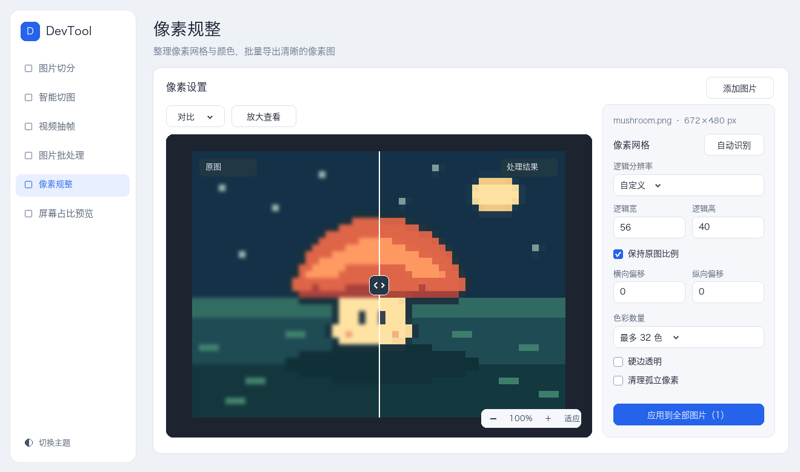
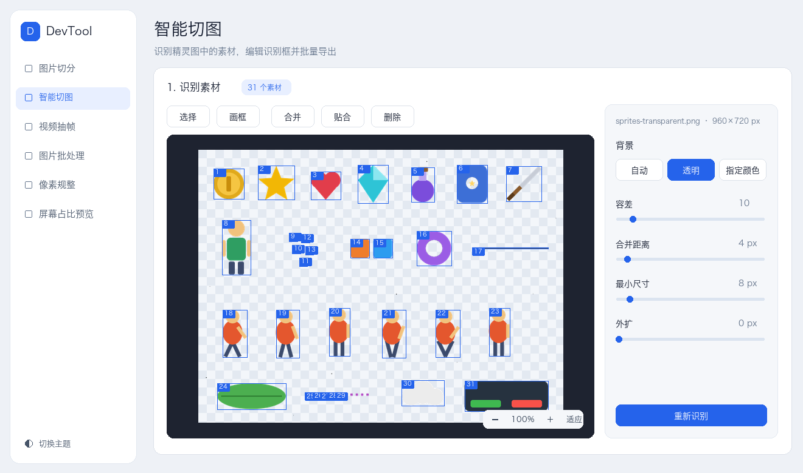

# DevTool 本地开发工具箱

DevTool 把图片切分、精灵图识别、视频抽帧、图片批处理、像素规整和屏幕占比预览放在同一个本地页面。所有图像和视频处理都在浏览器内完成，Node.js 负责托管静态文件。

## 页面演示

演示图用合成素材和工具的实际处理结果绘制，用于展示界面与操作效果。

| 像素规整 | 智能切图 |
|---|---|
|  |  |
| 调整逻辑分辨率和颜色，拖动画布分界线对比，并将同一套参数应用到多张图片。 | 自动识别精灵图素材，可编辑边框并导出独立图片和 `sprites.json`。 |

## 快速开始

需要 Node.js 22 或更新版本。下载或克隆仓库后，在项目目录运行以下命令。

```bash
npm start            # 等同 node server.js，默认 http://127.0.0.1:5180
PORT=8080 npm start  # 可用 PORT / HOST 环境变量覆盖
```

启动后访问 [http://127.0.0.1:5180/](http://127.0.0.1:5180/)，在侧栏选择工具，再选择、拖拽或粘贴素材。项目可以直接运行，无需安装 npm 依赖或构建。

- 改完前端文件刷新浏览器即可；改了 `server.js` 需要重启服务。
- 推荐使用 Chrome / Edge：可以直接保存到文件夹，AI 补帧可以用 GPU。其他浏览器保存时改为下载 ZIP。

## 工具

| 工具 | 用途 |
|---|---|
| 图片切分 | 按固定宽高把一张图切成网格小块，输出 PNG / JPEG / WebP |
| 智能切图 | 自动识别一张图里大小不一的素材并框选裁切，可手动编辑框，输出图片和 sprites.json |
| 视频抽帧 | 从视频或 GIF 逐帧抽图，去除背景、补帧、挑选帧、预览动画、导出 GIF |
| 图片批处理 | 批量导入图片，排序、去除背景、补帧、预览动画、保存或导出 GIF |
| 像素规整 | 批量将 AI 生成或边缘模糊的像素风图片整理成统一网格，归并杂色，整数倍放大输出 PNG |
| 屏幕占比预览 | 把素材摆到指定设备分辨率的屏幕上，查看尺寸和面积占比 |

### 支持的格式

- 图片：浏览器能解码的位图（PNG、JPEG、WebP、GIF、BMP、AVIF 等）与 SVG 矢量图。SVG 按所选倍数渲染为位图处理；图片切分和智能切图可以输出保留矢量的 SVG 切片。AI、EPS、PDF 暂不支持。
- 视频：浏览器能播放的格式（MP4、WebM、MOV 等）；GIF 动图也可以在视频抽帧中按原始帧抽取。

### 页面布局

- 宽屏采用左侧预览、右侧设置；窗口变窄或展开侧栏后空间不足时，自动改为上下排列。
- 编辑、选择和补帧各有独立的操作区域，同一区域的按钮、下拉框和输入框保持统一尺寸；主要操作使用蓝色按钮。
- 操作方法与快捷键可悬停对应控件查看；页面仅保留必要的参数、进度及输出提醒。
- 可缩放画布内的滚轮仅控制画布缩放，不带动主页面滚动；将鼠标移到画布外可正常滚动页面。图片批处理的悬浮预览小窗也适用。

### 补帧方式

视频抽帧和图片批处理都可以在相邻帧之间插入 1~3 帧：

| 方式 | 适合 |
|---|---|
| AI + 像素化修正（默认） | 像素画的造型变化。AI 估算动作，结果吸附回源帧颜色并对齐像素网格 |
| 像素位移 | 平移为主的动作（弹道、漂浮、行走起伏、UI 滑入），物体按整像素移动，不产生新颜色 |
| 帧保持 | 只想调整节奏，不生成新画面 |
| AI 平滑 | 高清、非像素风素材 |

首次使用 AI 方式时会加载约 50MB 的模型和推理引擎（之后在页面内缓存）。

### 保存到本地

- Chrome / Edge 可以直接保存到所选文件夹（同名文件会被覆盖），也可以打包 ZIP 下载。
- 浏览器不允许直接写入「桌面」「下载」「文档」等文件夹本身，请在其中新建子文件夹后选择；选完文件夹后浏览器会询问是否允许修改文件，需要点「允许」。

### 像素规整

- 支持多选、拖拽或粘贴导入 PNG / JPEG / WebP / BMP / AVIF 静态图片，多次导入会追加到列表。首次导入后自动预览并处理第一张，全程本地计算，无需加载 AI 模型。
- 先点击一张图片调整参数并查看效果，再点击右侧「应用到全部图片」，将逻辑宽高、偏移、色彩数量、硬边透明和孤立像素设置统一应用到所有图片。也可勾选部分图片，点击「应用到勾选图片」。图片过小或偏移不适用时会标出失败原因，并继续后续图片。
- 图片采用缩略图网格排列，点击哪张就预览哪张；画布左右箭头或键盘 ← / → 可切换上一张 / 下一张，快速连续切换以最后点击为准。切换图片保留当前统一设定，每张的已有结果和文件名独立保留；无结果的图片按当前设定生成预览。可全选、取消勾选、移除单张或清空；取消任务后已完成的结果保留。
- 「逻辑分辨率」决定美术像素的数量；例如将 1024×1024 图片整理为 128×128，再以 8 倍输出，得到每格 8×8 的 1024×1024 PNG。支持长边预设、自定义宽高、比例锁定和按原图像素调整网格偏移。
- 自动识别以当前图片提供网格建议；图片没有稳定网格时会提示手动调整。打开「网格」检查眼睛、轮廓等细节，参数修改后先更新当前预览，再用「应用到全部图片」一键处理其余图片，也可以取消任务。
- 默认整理为最多 32 色，可选保留原色或最多 16 / 64 / 128 色。默认保留每格代表色的透明度；「硬边透明」将透明度二值化。「清理孤立像素」默认关闭，开启可能删除高光或粒子。
- 支持原图 / 结果切换，直接拖动画布上的分界线对比，滚轮缩放和拖拽平移；可点击「放大查看」、缩略图放大按钮或双击图片打开大图窗口，大图中同样支持分界线、左右切图与缩放，Esc 关闭。两者按输出尺寸显示，网格和分界线只用于预览。
- 输出倍数支持 1 / 2 / 4 / 8 / 16，对全部勾选图片生效。勾选图片全部生成后，可批量保存文件夹、打包 ZIP 或发送到图片批处理；文件名按网格顺序添加补零序号，避免同名图片互相覆盖。
- 输入和输出最长边不超过 8192，最多 1600 万像素；逻辑宽高各为 1～512 且不超过原图尺寸。此功能整理网格与色彩，不保证自动修复原图的造型或缺失细节。

## 目录结构

```
server.js                    零依赖静态服务器（仅托管 public/，含路径穿越防护，开启跨源隔离）
scripts/gen-test-images.js   生成测试图到 test-images/（白底、透明底、品红底 PNG 精灵图 + SVG）
scripts/test-pixel-cleanup.mjs 像素规整纯数据检查（网格、颜色、透明度、批量队列、取消与保存）
docs/images/                 README 页面演示图
public/
  index.html                 应用外壳：侧栏、标题栏、正文容器、toast
  css/style.css              全部样式
  js/app.js                  工具注册、hash 路由、主题切换、侧栏固定 / 收起
  js/lib/ui.js               toast / collectRefs / downloadBlob / formatBytes / startProgress（进度卡片）
  js/lib/save.js             统一保存：选择文件夹写入或打包 ZIP
  js/lib/zip.js              仅存储（不压缩）的 ZIP 打包
  js/lib/gif.js              GIF89a 编码器
  js/lib/gif-decode.js       GIF 解码器
  js/lib/zoom.js             可缩放 / 平移视图
  js/lib/color-key.js        按颜色去除背景（色键）与颜色换算
  js/lib/vector.js           SVG 尺寸解析、栅格化、保留矢量的裁切
  js/lib/sprite-detect.js    素材识别算法
  js/lib/handoff.js          跨工具传递文件
  js/lib/interpolate.js      补帧入口（四种补帧方式，AI 方式动态加载 RIFE）
  js/lib/pixel-tween.js      像素风补帧算法
  js/lib/pixel-cleanup.js    像素规整：网格分析、代表色采样、调色板整理
  js/vendor/onnxruntime-web/ 推理引擎（见下方外部依赖）
  js/vendor/rife/            RIFE 补帧模型（见下方外部依赖）
  js/workers/sprite-detect.js  素材识别 Worker
  js/workers/pixel-cleanup.js 像素规整 Worker
  js/tools/image-slicer.js   工具：图片切分
  js/tools/smart-slicer.js   工具：智能切图
  js/tools/video-frames.js   工具：视频抽帧
  js/tools/image-batch.js    工具：图片批处理
  js/tools/pixel-cleanup.js  工具：像素规整
  js/tools/screen-preview.js 工具：屏幕占比预览
```

架构与实现细节见 [DESIGN.md](DESIGN.md)。

## 外部依赖

除下表外，ZIP、GIF 编解码等能力都在 `public/js/lib/` 里自行实现。依赖文件放在 `public/js/vendor/`，离线可用。

| 依赖 | 版本 | 来源 | 用途 |
|---|---|---|---|
| onnxruntime-web（MIT） | 1.31.1 | npm `onnxruntime-web` 的 `dist/`，只取 `ort.webgpu.min.mjs`、`ort-wasm-simd-threaded.asyncify.mjs` / `.wasm` | 在浏览器运行 RIFE 模型（WebGPU / WASM） |
| RIFE_fp32_timestep.onnx（MIT） | SHA-256 `4da60c1f…0319327` | HuggingFace `walterlow/RIFE_fp32_timestep`（基于 `FuryTMP/RIFE_fp32`，源自 hzwer/Practical-RIFE） | AI 补帧模型，插值位置 `timestep` 可在 0~1 之间任意取值 |

## 本地验证

测试素材由脚本生成到 `test-images/`。像素规整脚本覆盖网格、色彩、透明度、批量队列和取消保存。

```bash
node scripts/gen-test-images.js   # 生成 test-images/
node scripts/test-pixel-cleanup.mjs # 验证像素规整算法与取消保存
```
